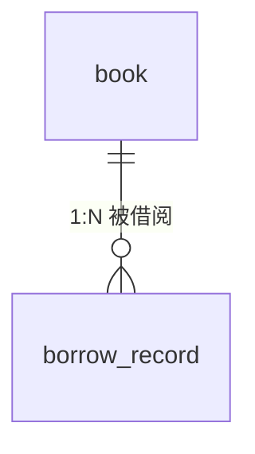

# 数据库设计

## 概述

- 数据库：MySQL 8.0+（测试使用 H2 内存库）
- 数据库名：library
- 字符集：utf8mb4
- ORM：Spring Data JPA（实体位于 `com.zjgsu.zyw.pojo`，数据访问代码位于 `com.zjgsu.zyw.repository`）

## 表关系

**book（图书）1 — N borrow_record（借阅记录）**

一本图书可被多次借阅产生多条借阅记录，每条借阅记录通过 `book_id` 关联一本书。



## 表结构

### 1. book（图书表，对应 Book 实体）

| 字段 | 类型 | 键/约束 | 说明 |
| --- | --- | --- | --- |
| id | INT | 主键（自增） | 主键 |
| title | VARCHAR(255) | — | 书名 |
| author | VARCHAR(255) | — | 作者 |
| publisher | VARCHAR(255) | — | 出版社 |
| category | VARCHAR(255) | — | 分类 |
| total_count | INT | — | 馆藏总册数 |
| available_count | INT | — | 可借数量 |
| status | VARCHAR(50) | — | AVAILABLE/BORROWED/REMOVED |
| location | VARCHAR(255) | — | 馆藏位置 |

### 2. borrow_record（借阅记录表，对应 BorrowRecord 实体）

| 字段 | 类型 | 键/约束 | 说明 |
| --- | --- | --- | --- |
| id | INT | 主键（自增） | 主键 |
| book_id | INT | — | 关联 book.id |
| reader_id | INT | — | 关联读者 |
| borrow_date | DATE | — | 借出日期 |
| due_date | DATE | — | 应还日期 |
| return_date | DATE | — | 实际归还日期，未还为 null |
| status | VARCHAR(50) | — | BORROWED/RETURNED/OVERDUE/LOST |
| overdue_days | INT | — | 逾期天数 |
| fine_amount | INT | — | 罚款金额 |

## 建表语句

```sql
CREATE DATABASE IF NOT EXISTS library DEFAULT CHARACTER SET utf8mb4;
USE library;

-- 图书表
CREATE TABLE book (
    id              INT           NOT NULL AUTO_INCREMENT COMMENT '主键',
    title           VARCHAR(255)  DEFAULT NULL COMMENT '书名',
    author          VARCHAR(255)  DEFAULT NULL COMMENT '作者',
    publisher       VARCHAR(255)  DEFAULT NULL COMMENT '出版社',
    category        VARCHAR(255)  DEFAULT NULL COMMENT '分类',
    total_count     INT           DEFAULT NULL COMMENT '馆藏总册数',
    available_count INT           DEFAULT NULL COMMENT '可借数量',
    status          VARCHAR(50)   DEFAULT NULL COMMENT '状态',
    location        VARCHAR(255)  DEFAULT NULL COMMENT '馆藏位置',
    PRIMARY KEY (id)
) ENGINE=InnoDB DEFAULT CHARSET=utf8mb4 COMMENT='图书表';

-- 借阅记录表
CREATE TABLE borrow_record (
    id            INT          NOT NULL AUTO_INCREMENT COMMENT '主键',
    book_id       INT          DEFAULT NULL COMMENT '关联 book.id',
    reader_id     INT          DEFAULT NULL COMMENT '关联读者',
    borrow_date   DATE         DEFAULT NULL COMMENT '借出日期',
    due_date      DATE         DEFAULT NULL COMMENT '应还日期',
    return_date   DATE         DEFAULT NULL COMMENT '实际归还日期',
    status        VARCHAR(50)  DEFAULT NULL COMMENT '状态',
    overdue_days  INT          DEFAULT NULL COMMENT '逾期天数',
    fine_amount   INT          DEFAULT NULL COMMENT '罚款金额',
    PRIMARY KEY (id)
) ENGINE=InnoDB DEFAULT CHARSET=utf8mb4 COMMENT='借阅记录表';
```

## 测试数据准备

- 主环境：`src/main/resources/data.sql` 使用固定主键 + `ON DUPLICATE KEY UPDATE` 幂等插入图书与借阅记录。
- 测试环境：测试类在 `@BeforeEach` 中通过 Repository 准备数据（H2 内存库，`ddl-auto: create-drop`），不依赖 data.sql，可重复执行。
