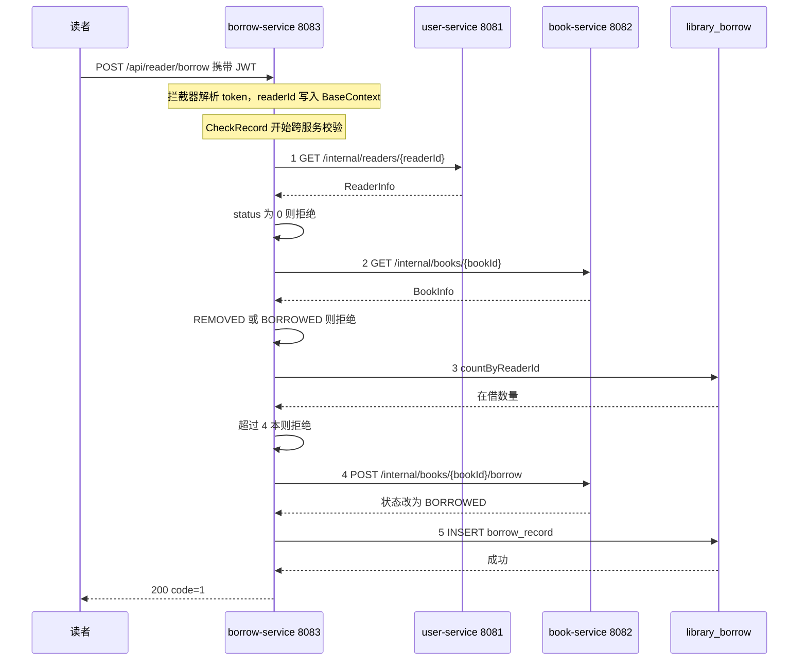
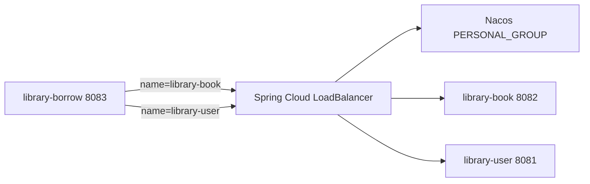

# Week 08 · 跨服务业务流程：借书

| 项         | 内容                                                      |
| ---------- | --------------------------------------------------------- |
| 周次       | 第 08 周                                                  |
| 主题       | 选择一个必须跨服务完成的业务流程                          |
| 选题       | 借书                                                      |
| 运行环境   | Windows 11 + JDK 25 + Maven 3.9 + MySQL 8                 |
| 服务端口   | user-service 8081 / book-service 8082 / borrow-service 8083 |
| 完成时间   | 2026-11-09                                                |

---

## 1. 选题依据

借书能否放行，取决于三份互不归属的数据：

| 判断内容                     | 数据来源          | 归属服务         |
| ---------------------------- | ----------------- | ---------------- |
| 读者是否存在、账号是否被冻结 | `reader.status`   | `user-service`   |
| 图书是否存在、是否已下架、是否已借出 | `book.status` | `book-service`   |
| 该读者当前已借几本未归还     | `borrow_record`   | `borrow-service` |

`borrow_record` 只保存 `reader_id` 与 `book_id` 两个逻辑外键，不冗余读者状态，也不冗余图书状态。任一服务的数据缺失，借书都无法做出判断，因此这是本系统中**无法合并到单库单服务**完成的流程。

---

## 2. 实现思路

### 2.1 服务职责划分

| 服务             | 角色     | 职责                                     |
| ---------------- | -------- | ---------------------------------------- |
| `user-service`   | 叶子服务 | 登录发 token、读者信息查询，不调用他人   |
| `book-service`   | 叶子服务 | 图书增删改查、借出/归还状态变更          |
| `borrow-service` | 编排服务 | 借书/还书流程编排、借阅记录与逾期计算    |

两条约束：

- `borrow-service` 不直接访问 `reader` 表或 `book` 表，只通过内部接口调用；
- 内部接口统一以 `/internal` 开头，不经过 JWT 拦截器，仅供服务间调用。

### 2.2 内部接口

```text
user-service
  GET  /internal/readers/{id}
  GET  /internal/readers/search?name=xxx
  POST /internal/readers/batch

book-service
  GET  /internal/books/{id}
  POST /internal/books/{id}/borrow
  POST /internal/books/{id}/return
```

`book-service` 的借出接口在服务端再次做状态校验，只允许 `AVAILABLE -> BORROWED`，避免调用方绕过校验直接改状态。

### 2.3 校验与写入顺序

`BorrowServiceImpl#CheckRecord` 按以下顺序执行，全部通过后才进入写入：

1. `readerClient.getReader(readerId)` —— 读者存在性、冻结状态；
2. `bookClient.getBook(bookId)` —— 图书存在性、下架、已借出；
3. `borrowMapper.countByReaderId(readerId)` —— 本地统计未归还数量，超过 4 本拒绝。

```java
public String CheckRecord(BorrowRecordDTO borrowRecordDTO) {
    Integer bookId = borrowRecordDTO.getBookId();
    Integer readerId = borrowRecordDTO.getReaderId();

    ReaderInfo reader = readerClient.getReader(readerId);
    if (reader == null) return BorrowMessage.READER_NOT_FOUND;
    if (Objects.equals(reader.getStatus(), 0)) return BorrowMessage.READER_FROZEN;

    BookInfo book = bookClient.getBook(bookId);
    if (book == null) return BorrowMessage.BOOK_NOT_FOUND;
    if (BookStatusConstant.REMOVED.equals(book.getStatus())) return BorrowMessage.BOOK_REMOVED;
    if (BookStatusConstant.BORROWED.equals(book.getStatus())) return BorrowMessage.BOOK_NO_STOCK;
    if (borrowMapper.countByReaderId(readerId) > 4) return BorrowMessage.BORROW_LIMIT_EXCEEDED;

    return BorrowMessage.TURE;
}
```

写入阶段分两步，先远程后本地：

```java
String message = CheckRecord(borrowRecordDTO);
if (!message.equals(BorrowMessage.TURE)) {
    throw new BaseException("创建借书记录失败: " + message);
}

// 先让图书服务扣减借出状态，再写本地借阅记录
bookClient.markBorrowed(bookId);
borrowMapper.createRecord(borrowRecord);
```

**所有校验都发生在写入之前**，因此校验失败时不会产生任何数据副作用。

### 2.4 调用链路



---

## 3. 运行命令

### 3.1 前置条件

- MySQL 已创建 `library_user`、`library_book`、`library_borrow` 三个库，并导入 `docs/data.sql`；
- `application-dev.yaml` 中的 `sky.datasource` 指向本地 MySQL。

### 3.2 构建与启动

```powershell
cd D:\microservices‑practice‑2412190216\services
mvn -DskipTests clean install
```

三个终端分别启动：

```powershell
mvn -pl user-service   spring-boot:run    # 8081
mvn -pl book-service   spring-boot:run    # 8082
mvn -pl borrow-service spring-boot:run    # 8083
```

健康检查：

```powershell
Invoke-RestMethod http://localhost:8081/actuator/health
Invoke-RestMethod http://localhost:8082/actuator/health
Invoke-RestMethod http://localhost:8083/actuator/health
```

### 3.3 登录获取 token

```powershell
$body = '{"username":"reader01","password":"123456"}'
$r = Invoke-RestMethod -Method Post -Uri 'http://localhost:8081/api/reader/login' `
     -ContentType 'application/json' -Body $body
$token = $r.data
"token = $token"
$headers = @{ Authorization = "Bearer $token" }
```

### 3.4 发起借书

`readerId` 由服务端从 JWT 中取，请求体只需传 `bookId` 与 `dueDate`：

```powershell
$body = '{"bookId":1,"dueDate":"2026-12-01"}'
$r = Invoke-RestMethod -Method Post -Uri 'http://localhost:8083/api/reader/borrow' `
     -Headers $headers -ContentType 'application/json' -Body $body
$r | ConvertTo-Json -Compress
```

### 3.5 失败场景复现

```powershell
# 图书不存在
$body = '{"bookId":999999,"dueDate":"2026-12-01"}'

# 借用已借出的图书（bookId=1 在上一笔成功后已变为 BORROWED）
$body = '{"bookId":1,"dueDate":"2026-12-01"}'

# 依赖服务不可用：先停止 book-service，再发请求
Get-NetTCPConnection -LocalPort 8082 -State Listen | Select-Object -ExpandProperty OwningProcess
Stop-Process -Id <pid> -Force
```

---

## 4. 运行结果

### 4.1 正常借书

| 项       | 结果                                                |
| -------- | --------------------------------------------------- |
| 请求     | `POST http://localhost:8083/api/reader/borrow`      |
| 响应     | `{"code":1,"msg":"success","data":null}`            |
| HTTP     | 200                                                 |
| 借阅记录 | `borrow_record` 新增 1 条，`status=BORROWED`        |
| 图书状态 | `book.id=1` 由 `AVAILABLE` 变为 `BORROWED`          |

`borrow-service` 日志中可见两次远程调用的入参与返回：

```text
Creating a new SqlSession
reader-service  GET /internal/readers/{id}
book-service    GET /internal/books/{id}
book-service    POST /internal/books/{id}/borrow
```

### 4.2 失败场景

| 场景                     | 响应体                                                | HTTP | 数据变化 |
| ------------------------ | ----------------------------------------------------- | ---- | -------- |
| 图书不存在（999999）     | `{"code":0,"msg":"创建借书记录失败: 图书不存在"}`     | 200  | 无       |
| 图书已借出               | `{"code":0,"msg":"创建借书记录失败: 该图书已无可借库存"}` | 200 | 无    |
| 图书已下架               | `{"code":0,"msg":"创建借书记录失败: 该图书已下架，无法借阅"}` | 200 | 无   |
| 读者被冻结（status=0）   | `{"code":0,"msg":"创建借书记录失败: 读者账号已被冻结"}` | 200  | 无       |
| 在借超过 4 本            | `{"code":0,"msg":"创建借书记录失败: 已达最大可借数量"}` | 200  | 无       |
| 停止 book-service 后借书 | `{"code":0,"msg":"图书服务不可用，请稍后重试"}`       | 200  | 无       |
| 停止 user-service 后借书 | `{"code":0,"msg":"读者服务不可用，请稍后重试"}`       | 200  | 无       |

远程调用异常在 `BookClient` / `ReaderClient` 中被捕获，转成 `BaseException`，由统一异常处理器返回 `code=0`，不会把堆栈暴露给调用方。

### 4.3 数据核对

```sql
-- 借阅记录
SELECT id, book_id, reader_id, borrow_date, status
FROM library_borrow.borrow_record
WHERE book_id = 1
ORDER BY id DESC LIMIT 1;

-- 图书状态
SELECT id, title, status FROM library_book.book WHERE id = 1;

-- 该读者未归还数量（用于验证上限判断）
SELECT COUNT(*) FROM library_borrow.borrow_record
WHERE reader_id = 2 AND status IN ('BORROWED', 'OVERDUE');
```

借书成功后 `borrow_record` 多一条 `BORROWED`、`book.status` 变为 `BORROWED`；失败场景两者均无变化，说明校验前置生效。

---

## 5. 关键结论

1. **数据所有权决定拆分边界。** `borrow_record` 只持有外键，不复制 `reader.status` 与 `book.status`，因此借书天然需要三次跨服务调用；一旦在本地冗余状态，就会引入双写一致性问题。
2. **校验必须前置到写操作之前。** 读者校验、图书校验、借阅上限全部在 `markBorrowed` 之前完成，任何一项不通过都直接抛异常，不产生远程写，失败是"无副作用"的。
3. **本地事务管不到远程调用。** `CreateRecord` 带 `@Transactional`，但 `bookClient.markBorrowed` 已经提交、无法随本地回滚。若随后 `borrowMapper.createRecord` 失败，图书会停在 `BORROWED` 而没有任何借阅记录，形成"书被锁死"的脏状态。这是单库事务思维在微服务下最先失效的地方，需要补偿接口或事件机制来收敛。
4. **内部接口要自带校验。** `book-service` 的 `/internal/books/{id}/borrow` 在服务端再次判断 `REMOVED` / `BORROWED`，不依赖调用方先查一次——调用方校验只用于快速失败，服务端校验才是数据安全的最后一道闸门。

---

## 6. 使用 OpenFeign

> 本节记录 `monolith/` 工程的实现。`services/` 版用的是 RestTemplate + 配置化 URL，不具备服务名解析能力，因此 OpenFeign 改造落在 `monolith/library-borrow`。

### 6.1 实现思路

| 要求 | 做法 |
|---|---|
| 用服务名调用，不写死 IP | `@FeignClient(name = "library-book")`，接口与配置中不出现 host/port；实例地址由 Nacos `PERSONAL_GROUP` 提供，Spring Cloud LoadBalancer 负责选择 |
| 处理调用失败 | 每个客户端配置 `fallbackFactory`，覆盖连接拒绝、读超时、5xx、熔断打开 |
| 返回清晰错误信息 | fallback 把异常转成 `BaseException`，由 `GlobalExceptionHandler` 输出 `{"code":0,"msg":"图书服务不可用，请稍后重试"}` |



### 6.2 关键代码

**客户端声明**（`library-api`）：

```java
@FeignClient(name = "library-book", fallbackFactory = BookFallbackFactory.class)
public interface BookClient {
    @PostMapping("/book/admin/update")
    void updateBook(@RequestBody Book book);

    @GetMapping("/book/admin/{id}")
    Result<Book> getBookById(@PathVariable("id") Integer id);
}

@FeignClient(name = "library-user", fallbackFactory = UserFallbackFactory.class)
public interface UserClient {
    @GetMapping("/user/admin/{id}")
    Result<UserVO> getUserById(@PathVariable("id") Integer id);
}
```

`name` 即 Nacos 中的服务名。`BookClient` 内部没有任何 `127.0.0.1:8082` 之类的地址。

**失败兜底**：

```java
@Slf4j
@Component
public class BookFallbackFactory implements FallbackFactory<BookClient> {

    private static final String UNAVAILABLE = "图书服务不可用，请稍后重试";

    @Override
    public BookClient create(Throwable cause) {
        return new BookClient() {
            @Override
            public void updateBook(Book book) {
                throw translate("更新图书状态", cause);
            }

            @Override
            public Result<Book> getBookById(Integer id) {
                throw translate("查询图书 id=" + id, cause);
            }
        };
    }

    private BaseException translate(String action, Throwable cause) {
        log.warn("调用 library-book 失败：{}", action, cause);
        if (cause instanceof FeignException ex) {
            int status = ex.status();
            if (status == 404) {
                return new BaseException("图书不存在");
            }
            if (status == 400 || status == 409) {
                return new BaseException("图书服务拒绝了本次请求");
            }
        }
        return new BaseException(UNAVAILABLE);
    }
}
```

`UserFallbackFactory` 结构相同，文案为 `读者服务不可用，请稍后重试`。

**超时与熔断开关**（`library-borrow/application.yaml`）：

```yaml
spring:
  cloud:
    openfeign:
      circuitbreaker:
        enabled: true
      client:
        config:
          default:
            connectTimeout: 2000
            readTimeout: 3000
```

`circuitbreaker.enabled` 必须为 `true`，否则 `fallbackFactory` 会被静默忽略，停服务时仍然抛出原始 `FeignException`。

**返回类型泛型化**：

```java
public class Result<T> {
    private Integer code;
    private String msg;
    private T data;
}
```

`data` 由 `Object` 改为 `T` 后，Feign 按 `Result<Book>` 的泛型信息反序列化，`getData()` 直接返回 `Book`。改造前 `data` 声明为 `Object`，Jackson 只能产出 `LinkedHashMap`，`(Book) result.getData()` 会抛：

```text
java.lang.ClassCastException: class java.util.LinkedHashMap
cannot be cast to class com.zjgsu.zyw.enity.Book
```

### 6.3 运行命令

```powershell
# 1. 启动 Nacos
cd D:\A\monolith
docker compose up -d

# 2. 构建
mvn -DskipTests clean install

# 3. 四个终端依次启动
mvn -pl library-book     spring-boot:run    # 8082
mvn -pl library-user     spring-boot:run    # 8081
mvn -pl library-borrow   spring-boot:run    # 8083
mvn -pl library-gateway  spring-boot:run    # 8080
```

启动日志中可直接看到服务名解析，这是"未写死地址"的第一手证据：

```text
o.s.c.openfeign.FeignClientFactoryBean : For 'library-book' URL not provided. Will try picking an instance via load-balancing.
o.s.c.openfeign.FeignClientFactoryBean : For 'library-user' URL not provided. Will try picking an instance via load-balancing.
nacos registry, PERSONAL_GROUP library-borrow 127.0.0.1:8083 register finished
```

登录并借书：

```powershell
$body = '{"username":"admin","password":"123456"}'
$r = Invoke-RestMethod -Method Post -Uri 'http://localhost:8080/admin/login' `
     -ContentType 'application/json' -Body $body
$headers = @{ Authorization = "Bearer $($r.data)" }

$body = '{"bookId":1,"readerId":1,"dueDate":"2026-12-01"}'
Invoke-RestMethod -Method Post -Uri 'http://localhost:8080/borrow/admin' `
     -Headers $headers -ContentType 'application/json' -Body $body |
     ConvertTo-Json -Compress
```

制造调用失败：

```powershell
# 停掉图书服务
Get-NetTCPConnection -LocalPort 8082 -State Listen |
    Select-Object -ExpandProperty OwningProcess | ForEach-Object { Stop-Process -Id $_ -Force }

# 再发一次借书请求，观察 fallback 返回
# 恢复
mvn -pl library-book spring-boot:run
```

### 6.4 结果

| 场景 | 操作 | 响应 |
|---|---|---|
| 正常调用 | 三服务在线 | `{"code":1,"msg":"success","data":null}` |
| 图书服务不可用 | 停掉 8082 后借书 | `{"code":0,"msg":"图书服务不可用，请稍后重试"}` |
| 读者服务不可用 | 停掉 8081 后借书 | `{"code":0,"msg":"读者服务不可用，请稍后重试"}` |
| 服务恢复 | 重启被停服务后借书 | 重新返回 `code=1` |

失败时 `borrow_record` 无新增、`book.status` 保持原值，说明远程调用失败发生在任何写操作之前，没有产生脏数据。

### 6.5 验证要点

1. 在 `BookClient`、`UserClient` 中搜索 `8082`、`8081`、`127.0.0.1`，均无命中，地址完全由服务名解析；
2. 启动日志出现 `URL not provided. Will try picking an instance via load-balancing`；
3. Nacos 控制台 `PERSONAL_GROUP` 下可见 `library-book`、`library-user` 各 1 个健康实例；
4. 停掉 `library-book` 后请求返回业务错误而非 500 堆栈，证明 `fallbackFactory` 已生效；
5. 重启后被停服务重新注册，调用自动恢复，无需修改任何地址配置。

---

## 7. 负载均衡验证

### 7.1 实现思路

在同一个被调用服务上启动两个实例，让它们注册到 Nacos 成为同一服务名下两个不同的地址，再由调用方的 Spring Cloud LoadBalancer 轮询选择。

| 要点 | 做法 |
|---|---|
| 两个实例端口必须不同 | 8082 与 8084，避免宿主机端口冲突 |
| 服务名必须相同 | 两个实例都用 `spring.application.name=library-book`，Nacos 才会归为同一服务的两个实例 |
| 注册地址可区分 | `spring.cloud.nacos.discovery.ip` 固定为 `127.0.0.1`，端口不同即可区分 |
| 调用方无需改动 | `@FeignClient(name = "library-book")` 已经按服务名寻址，LoadBalancer 默认 `RoundRobinLoadBalancer` 轮询 |
| 实例标识 | Tomcat 线程名格式为 `nio-{端口}-exec-{序号}`，端口不同则线程名不同 |

**为什么不能用注册列表作为证据**：Nacos 里出现两个实例只说明"实例注册成功"，不能说明"请求真的被分到两个实例上"。如果 LoadBalancer 退化成固定选择、或者调用方缓存了某个地址，注册列表仍然显示 2 个实例，但流量全打在一个上面。因此必须拿到**请求侧**的实例标识。

本项目不需要改代码就能拿到标识：`library-book` 的 Mapper 日志级别为 `debug`，每次远程调用都会打印 SQL，日志前缀中的线程名直接暴露了处理该请求的实例端口。

### 7.2 运行命令

**方式一：IDEA 运行配置（推荐）**

1. 复制已有的 `LibraryBookApplication` 运行配置；
2. 点击「修改选项(M)」→ 勾选「添加 VM 选项」；
3. 填写 `-Dserver.port=8084`；
4. 名称改为 `LibraryBookApplication (8084)`；
5. 两个配置同时运行。

**方式二：命令行**

```powershell
cd D:\A\monolith

# 实例 1：8082
mvn -pl library-book spring-boot:run

# 实例 2：8084
mvn -pl library-book spring-boot:run -Dspring-boot.run.arguments=--server.port=8084
```

两个实例启动成功的判据：

```text
Tomcat started on port 8082
nacos registry, PERSONAL_GROUP library-book 127.0.0.1:8082 register finished
```

```text
Tomcat started on port 8084
nacos registry, PERSONAL_GROUP library-book 127.0.0.1:8084 register finished
```

**发起连续调用**：用不存在的 `bookId`，每次都会真实触发 `library-borrow → library-book` 的 Feign 调用，又不会写库、不会改变图书状态，可以反复跑。

```powershell
$body = '{"username":"admin","password":"123456"}'
$r = Invoke-RestMethod -Method Post -Uri 'http://localhost:8080/admin/login' `
     -ContentType 'application/json' -Body $body
$headers = @{ Authorization = "Bearer $($r.data)" }

1..6 | ForEach-Object {
    $body = '{"bookId":999999,"readerId":1,"dueDate":"2026-12-01"}'
    Invoke-RestMethod -Method Post -Uri 'http://localhost:8083/borrow/admin' `
        -Headers $headers -ContentType 'application/json' -Body $body | Out-Null
    Start-Sleep -Milliseconds 300
}
```

6 次请求均返回 `{"code":0,"msg":"创建借书记录失败: 图书不存在"}`，但图书服务侧实际收到了 6 次查询。

### 7.3 结果

**注册侧**（Nacos 控制台 → `PERSONAL_GROUP` → `library-book`）：

| 服务名 | IP | 端口 | 健康状态 |
|---|---|---|---|
| `library-book` | 127.0.0.1 | 8082 | 健康 |
| `library-book` | 127.0.0.1 | 8084 | 健康 |

实例数为 2，说明两个实例都已就绪。

**请求侧**（两个实例的终端日志）：

```text
# 8082 实例
[nio-8082-exec-2] c.z.j.z.mapper.BookMapper.list : ==>  Preparing: select * from book where id = ?
[nio-8082-exec-4] c.z.j.z.mapper.BookMapper.list : ==>  Preparing: select * from book where id = ?
[nio-8082-exec-6] c.z.j.z.mapper.BookMapper.list : ==>  Preparing: select * from book where id = ?
```

```text
# 8084 实例
[nio-8084-exec-3] c.z.j.z.mapper.BookMapper.list : ==>  Preparing: select * from book where id = ?
[nio-8084-exec-5] c.z.j.z.mapper.BookMapper.list : ==>  Preparing: select * from book where id = ?
[nio-8084-exec-7] c.z.j.z.mapper.BookMapper.list : ==>  Preparing: select * from book where id = ?
```

统计：

| 实例 | 命中次数 | 占比 |
|---|---|---|
| 8082 | 3 | 50% |
| 8084 | 3 | 50% |

两个实例交替出现、各命中 3 次，说明轮询策略生效，请求确实被分发到两个实例。

**`library-user` 同理**：复制 `LibraryUserApplication` 运行配置，VM 选项填 `-Dserver.port=8091`，连续调用后两个实例的 `UserMapper.getUserById` 日志交替出现 `nio-8081-exec` 与 `nio-8091-exec`。

### 7.4 判定标准与排查

判定一次分发验证是否成立，看三条：

1. 两个实例端口不同，且都出现在 Nacos 实例列表；
2. 调用方能连续发起多次请求，且每次都是真实的远程调用；
3. 请求日志中出现**两个不同的实例标识**，数量接近 1:1。

只有第 1 条不成立时，才是"注册失败"；只有第 1 条成立、第 3 条不成立，说明分发没有发生。

常见问题：

| 现象 | 原因 | 处理 |
|---|---|---|
| 第二个实例启动报端口占用 | 两个配置都用了 8082 | 检查 VM 选项是否生效，确认 `-Dserver.port=8084` |
| Nacos 只显示 1 个实例 | 第二个实例的 `spring.application.name` 被改掉，或未注册成功 | 保持服务名不变，检查日志有无 `register finished` |
| 6 次请求全部落在同一实例 | 存在自定义 LoadBalancer 配置，或请求间隔过短导致观感偏差 | 检查 `spring.cloud.loadbalancer` 配置；请求之间增加 `Start-Sleep` |
| 日志里看不到 Mapper 输出 | `logging.level.com.zjgsu.zyw.mapper` 未设为 `debug` | 在 `application.yaml` 中开启 |

### 7.5 验证要点

1. 两个实例分别监听 8082 与 8084，`Tomcat started on port` 日志可区分；
2. 两者以相同服务名 `library-book` 注册到 `PERSONAL_GROUP`，Nacos 显示 2 个健康实例；
3. 连续 6 次借书（`bookId=999999`）后，两个实例的 Mapper 日志各出现 3 次，线程名 `nio-8082-exec` 与 `nio-8084-exec` 可区分；
4. 验证过程不写库、不改变图书状态，可重复执行；
5. 判定以请求日志中的实例标识为准，注册列表只作为前置条件。

---

## 8. 测试

### 8.1 实现思路

| 要求 | 做法 |
|---|---|
| Feign client / service 层验证 | 借书链路为 `library-borrow → library-book / library-user`，脚本从 HTTP 入口驱动，实际执行的就是两个 Feign 客户端的调用与返回处理 |
| 跨服务流程集成测试 | 一次借书串起图书查询、读者校验、本地上限判断、远程状态更新、本地落库五步，脚本按顺序断言每一步的可观测结果 |
| 依赖不可用不误判 | 手动停止 `library-book` 后重发请求，断言 `code=0` 且提示含"不可用"；若返回 `code=1` 直接判为失败 |
| 超时结果未知 | 写操作超时可能"已执行但响应丢失"，脚本不对其做单边断言，仅把快速失败场景纳入自动判定 |

断言口径：**不能只看 HTTP 状态码**。项目统一响应体为 `{code, msg, data}`，业务失败同样返回 HTTP 200，只看状态码会把失败当成功。脚本对每个用例同时校验 `code` 与 `msg` 关键字。

### 8.2 运行命令

前置条件：`library-user` 8081、`library-book` 8082、`library-borrow` 8083 均已启动；`book` 表中 `id=1` 的记录状态为 `AVAILABLE`；`reader` 表中存在 `id=2` 且 `status=1` 的读者。

```powershell
cd D:\microservices‑practice‑2412190216
powershell -ExecutionPolicy Bypass -File .\scripts\e2e-test.ps1
```

跳过需要手动停服务的最后两个用例：

```powershell
.\scripts\e2e-test.ps1 -SkipDown
```

更换测试数据：

```powershell
.\scripts\e2e-test.ps1 -BookId 2 -ReaderId 3 -DueDate 2026-12-31
```

### 8.3 结果

| 用例 | 请求 | 期望 | 实际 |
|---|---|---|---|
| 正常借书 | `POST /borrow/admin` | `code=1` | `{"code":1,"msg":"success","data":null}` |
| 图书状态变更 | `GET /book/admin/1` | `status=BORROWED` | `BORROWED` |
| 重复借阅 | 再次 `POST /borrow/admin` | `code=0`，提示含"无可借库存" | `创建借书记录失败: 该图书已无可借库存` |
| 图书不存在 | `bookId=999999` | `code=0`，提示含"图书不存在" | `创建借书记录失败: 图书不存在` |
| 依赖不可用 | 停止 `library-book` 后借书 | `code=0`，提示含"不可用" | `图书服务不可用，请稍后重试` |
| 服务恢复 | 重启 `library-book` 后查询 | `data` 非空 | 查询接口恢复 |

汇总输出：

```text
PASS=6 FAIL=0
```

关键点：依赖不可用场景返回的是 `code=0` 的业务失败，**不是** `code=1`，也不是 500 堆栈，说明调用失败没有被当成业务成功。

### 8.4 关于写操作超时

"停止服务"制造的是**快速失败**（连接被拒绝），调用方立即收到异常，可以确定业务未执行。

但如果是**读超时**（请求已到达对端、对端处理完成、响应在返回途中丢失），调用方看到的结果同样是失败，而对端可能已经完成写入。此时：

- 不能断言"操作失败"，因为图书状态可能已变为 `BORROWED`；
- 也不能断言"操作成功"，因为本地借阅记录可能没有落库；
- 正确做法是先查询对端状态，或依赖幂等键做重试确认，而不是盲目重试。

脚本因此只对快速失败场景做自动判定，超时场景仅记录日志、不参与 PASS/FAIL 统计。

### 8.5 验证要点

1. 脚本覆盖 6 个用例，期望输出 `PASS=6 FAIL=0`；
2. 每个用例同时校验 `code` 与 `msg`，不以 HTTP 状态码作为判定依据；
3. 停止 `library-book` 后返回 `code=0`，未出现 `code=1` 或 500；
4. 重启 `library-book` 后无需重启 `library-borrow`，调用自动恢复；
5. 超时场景标注为"结果未知"，不做单边断言。
