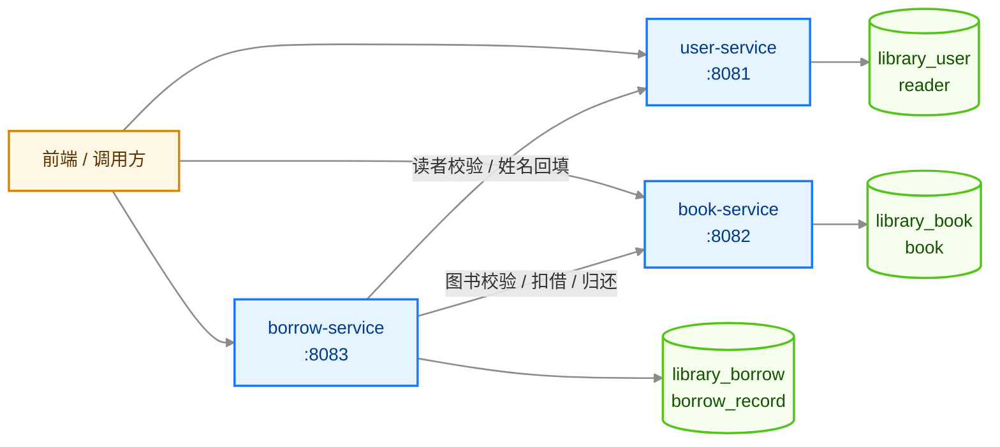
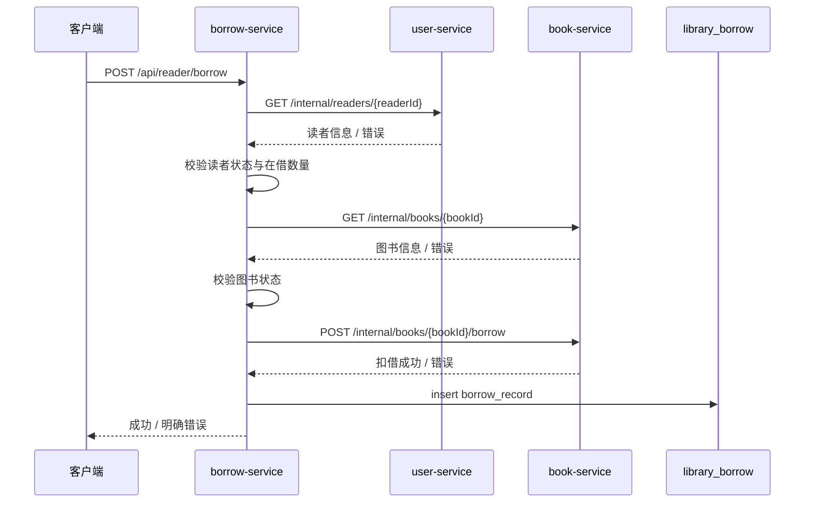
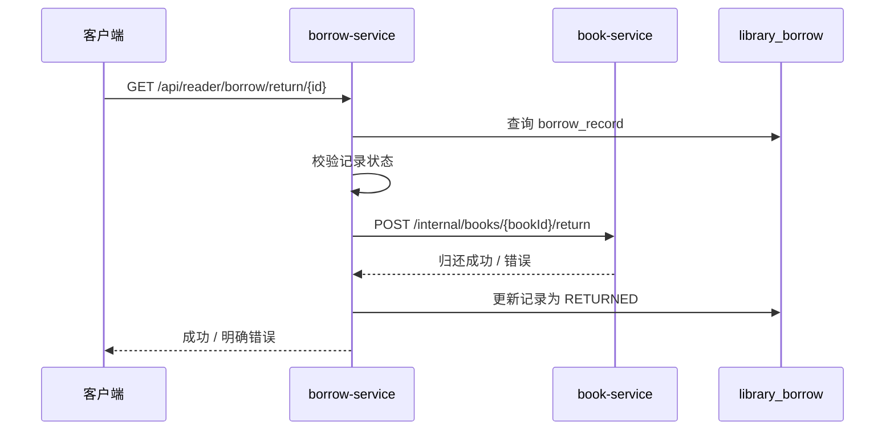

# 微服务拆分设计

## 1. 项目背景与拆分目标

原系统 `monolith/` 由三部分组成：

```text
monolith/
├── monolith-common/   常量、JWT、上下文、异常
├── monolith-pojo/     实体、DTO、VO、统一响应
└── monolith-server/   Controller、Service、Mapper、定时任务
```

单体内部包含三类业务能力：

1. 用户/读者：登录、账号类型、状态、读者信息；
2. 图书：图书信息维护、查询、借出/归还状态；
3. 借阅：借书、还书、借阅记录、逾期检查。

本次拆分目标：

- 按业务领域与能力边界拆分，而不是按 Controller、Service、Repository 技术层拆分；
- 每个服务独立启动、独立部署、独立数据库；
- 服务之间只通过 HTTP 接口协作；
- 保留 `monolith/` 作为单体版本，新代码放在 `services/` 下。

## 2. 拆分原则

1. 按业务能力拆分：读者、图书、借阅分别归属不同服务。
2. 数据所有权单一：每张表只能由一个服务读写。
3. 服务独立部署：每个服务有独立 `pom.xml`、启动类、端口和数据库。
4. 跨服务只通过 API：不直接访问对方数据库，不调用对方 Mapper/Repository。
5. 不建立跨库外键：只保存对方的业务 ID，如 `reader_id`、`book_id`。
6. 先保证边界清晰，再考虑分布式事务、消息、网关等后续能力。

## 3. 单体模块到微服务的映射

| 单体中的代码/模块 | 迁移到 | 说明 |
|---|---|---|
| `controller/admin/AdminController`、`controller/user/ReaderController` | `user-service` | 管理员登录、读者登录 |
| `controller/admin/UserController`、`controller/user/UserController` | `user-service` | 读者分页、新增、改类型、改状态、查询当前读者 |
| `UserService`、`UserServiceImpl`、`UserMapper`、`UserMapper.xml` | `user-service` | 读者业务与 `reader` 表访问 |
| `JwtUtil`、`JwtProperties`、`BaseContext`、JWT 拦截器 | `user-service` | 登录签发 token，并校验受保护接口 |
| `controller/admin/BookController`、`controller/user/BookController` | `book-service` | 管理员图书维护、读者图书查询 |
| `BookService`、`BookServiceImpl`、`BookMapper`、`BookMapper.xml` | `book-service` | 图书业务与 `book` 表访问 |
| `controller/admin/BorrowController`、`controller/user/BorrowController` | `borrow-service` | 管理员/读者借阅接口 |
| `BorrowService`、`BorrowServiceImpl`、`BorrowMapper`、`BorrowMapper.xml` | `borrow-service` | 借书、还书、借阅记录查询 |
| `CheckTimeOut` | `borrow-service` | 逾期检查，只更新借阅记录 |
| `monolith-pojo` 中的实体、DTO、VO | 按领域复制到各服务 | 每个服务只保留自己需要的类，不依赖原 `monolith-pojo` |
| `monolith-common` 中的常量、异常、JWT、`BaseContext` | 按需复制到各服务 | 不通过 Maven 依赖原 `monolith-common`，避免编译期耦合 |
| `WebMvcConfiguration`、`GlobalExceptionHandler` | 按需复制到各服务 | 每个服务独立注册拦截器与异常处理 |

拆分后的代码仍使用基础包名 `com.zjgsu.zyw`。

## 4. 服务职责、端口与数据归属

| 服务 | 端口 | 独立数据库 | 拥有的表 | 核心职责 |
|---|---:|---|---|---|
| `user-service` | 8081 | `library_user` | `reader` | 管理员/读者登录、读者信息、账号状态、JWT 签发 |
| `book-service` | 8082 | `library_book` | `book` | 图书增删改查、图书状态维护、借出/归还状态变更 |
| `borrow-service` | 8083 | `library_borrow` | `borrow_record` | 借书、还书、借阅记录、逾期检查、跨服务流程编排 |

数据库账号：

| 服务 | 账号 |
|---|---|
| `user-service` | `user_svc` |
| `book-service` | `book_svc` |
| `borrow-service` | `borrow_svc` |

每个服务只配置自己的数据库账号，不跨库读写。

## 5. 服务调用关系



内部接口清单：

```text
user-service
  GET  /internal/readers/{id}
  GET  /internal/readers/search?name=xxx
  POST /internal/readers/batch

book-service
  GET  /internal/books/{id}
  POST /internal/books/{id}/borrow
  POST /internal/books/{id}/return
```

调用原则：

- `user-service` 和 `book-service` 是叶子服务，不调用其他服务；
- `borrow-service` 是流程编排服务，负责借书/还书的跨服务调用；
- `borrow-service` 不直接访问 `reader` 表或 `book` 表；
- `borrow-service` 不调用 `UserMapper`、`BookMapper` 或对方 Repository；
- 内部接口统一以 `/internal/**` 开头，不经过 JWT 拦截器，仅供服务间调用。

## 6. 数据所有权设计

### 6.1 每服务独占数据

| 表 | 归属服务 | 说明 |
|---|---|---|
| `reader` | `user-service` | 只有 `user-service` 可以读写 |
| `book` | `book-service` | 只有 `book-service` 可以读写 |
| `borrow_record` | `borrow-service` | 只有 `borrow-service` 可以读写 |

### 6.2 跨服务只保存 ID

`borrow_record` 中的：

- `reader_id`：逻辑关联 `user-service` 的 `reader.id`；
- `book_id`：逻辑关联 `book-service` 的 `book.id`。

两者都不建立跨库外键。原因是外键会让三个服务的数据生命周期和部署强耦合，也会阻止服务独立迁移数据库。

### 6.3 不跨库 JOIN

原单体 `BorrowMapper.xml` 中有：

```sql
select br.*, r.name
from borrow_record br
left join reader r on br.reader_id = r.id
```

拆分后该 JOIN 被移除，`borrow-service` 只查询本地 `borrow_record`，读者姓名通过 `user-service` 的批量接口回填：

```text
POST /internal/readers/batch
请求：[2, 3, 4]
响应：[{ "id": 2, "name": "xiaoming" }, ...]
```

按读者姓名筛选时，先调用：

```text
GET /internal/readers/search?name=xxx
```

拿到读者 ID 列表后，再按 `reader_id in (...)` 查询本地借阅记录。

## 7. 核心跨服务流程

### 7.1 借书流程



### 7.2 还书流程



5. 
