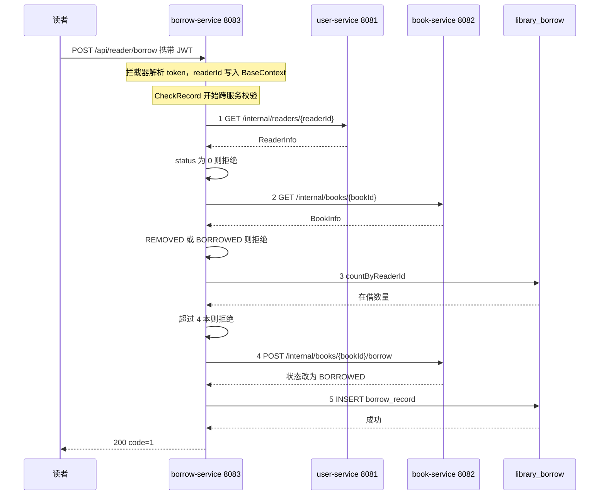

# 借书跨服务调用链路

## 链路说明

| 步骤 | 调用 | 说明 |
|---|---|---|
| 1 | `borrow-service` → `user-service` | `GET /internal/readers/{id}`，校验读者是否存在、账号是否被冻结 |
| 2 | `borrow-service` → `book-service` | `GET /internal/books/{id}`，校验图书是否存在、是否下架、是否已借出 |
| 3 | `borrow-service` → `library_borrow` | 本地统计该读者未归还记录数，超过上限则拒绝 |
| 4 | `borrow-service` → `book-service` | `POST /internal/books/{id}/borrow`，将图书状态由 `AVAILABLE` 改为 `BORROWED` |
| 5 | `borrow-service` → `library_borrow` | 写入借阅记录，`status = BORROWED` |

## 说明

借书必须跨服务完成，因为放行判断依赖三份互不归属的数据：

- 读者是否可借，由 `user-service` 的 `reader.status` 决定；
- 图书是否可借，由 `book-service` 的 `book.status` 决定；
- 读者已借几本，由 `borrow-service` 自己的 `borrow_record` 决定。

`borrow_record` 只保存 `reader_id` 和 `book_id` 两个逻辑外键，不冗余读者状态与图书状态，因此三次跨服务调用无法合并。

步骤 1 至 3 全部为校验，发生在任何写操作之前；步骤 4 与 5 才是写入。因此校验失败时不会产生数据副作用。步骤 4 先于步骤 5 执行，若本地写库失败，图书状态已改为 `BORROWED` 而借阅记录不存在，需要补偿处理。
